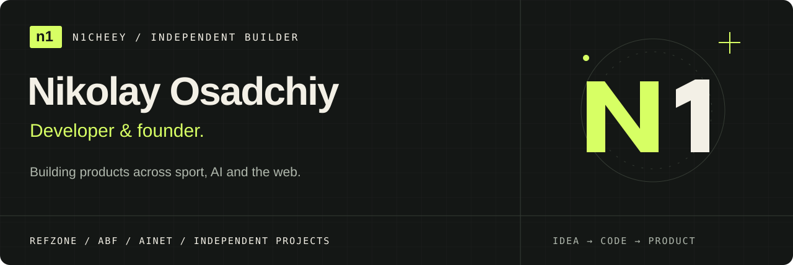
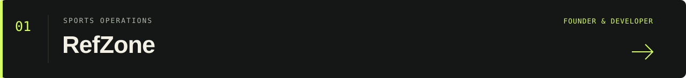
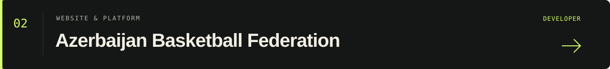
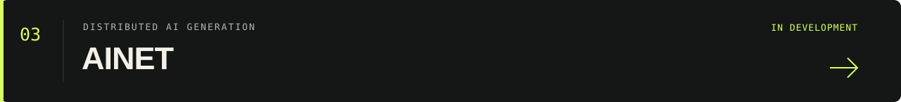
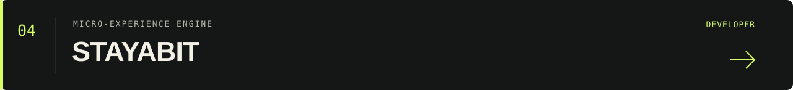
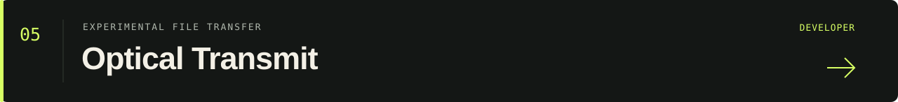

  

  <strong>DEVELOPER &amp; FOUNDER</strong> 
  Sports platforms. AI infrastructure. Independent products.

  <a href="#selected-projects">Selected projects</a> &nbsp; / &nbsp;
  <a href="#engineering-toolkit">Engineering toolkit</a> &nbsp; / &nbsp;
  <a href="#open-code">Open code</a>

---

## Turning ideas into working products.

I'm **Nikolay Osadchiy**, a developer and the founder of **RefZone**. I build web applications and digital tools, with a particular focus on sports and the workflows behind them.

My work includes the **Azerbaijan Basketball Federation website**, a platform for refereeing operations, and independent projects exploring AI generation, everyday experiences and browser-based file transfer. I work across interfaces, application logic and the services that connect them.

## Selected projects

### RefZone

**Founder & Developer** · Refereeing operations

A platform built around the day-to-day work of basketball referees and instructors. RefZone brings assignments, referee responses, reporting and rankings into a shared application, giving different participants the tools they need for their roles.

- **Assignment workflow:** nominations and referee responses in one place.
- **Reporting and review:** draft, submission and review stages for reports, alongside rankings and instructor administration tools.
- **Public statistics:** a separate Atlas application for presenting basketball statistics.

Built with React, Vite and Cloudflare. Data and authentication powered by Supabase.

 

### Azerbaijan Basketball Federation

**Website Developer** · Public website & content management

A web platform for the Azerbaijan Basketball Federation, combining a public website with a separate administration application. The project supports Azerbaijani and English interfaces and gives editorial work its own content management environment.

- **Bilingual experience:** Azerbaijani and English interfaces, with consistent names for teams and other entities.
- **Editorial tools:** a separate administration application and AI-assisted translation for news content.
- **Cloudflare architecture:** React and TypeScript applications backed by Workers, D1 and R2.

Focus: public-facing presentation, content workflows and application infrastructure.

 

### AINET

**Developer** · Distributed AI generation · **In development**

AINET is a project aimed at bringing the computing power of multiple computers together for AI image and video generation. The goal is to let several machines contribute resources to a generation workload instead of relying on a single computer.

The project explores distributed compute as the foundation for creative AI workflows, with image and video generation as its intended use cases. It is still in development; the source code has not been published yet.

Focus: distributed computing, AI infrastructure and generative media.

 

### STAYABIT

**Developer** · Micro-experience engine

A product that turns **5–120 minutes of free time** into small, real-world experiences. A curated catalogue of activities helps people find something to do, while discovery and progression features encourage them to keep exploring.

- **Discovery:** 312 curated activity ideas, a roulette selector and themed collections.
- **Progression:** daily challenges, XP, achievements and personal profiles.
- **Community:** social features and moderation tools, supported by server-rendered pages and a PWA experience.

Built with TypeScript, Cloudflare Workers and D1.

 

### Optical Transmit

**Developer** · Experimental browser-based file transfer

A research prototype exploring file transfer from a computer screen to an Android camera. A file is encoded into visual frames on the sending screen, while the receiving device uses its camera to read them. File processing happens locally in the browser.

The prototype includes marker tracking and Reed–Solomon error correction. It remains an experiment: physical Android camera testing is still pending, and real-world transfer performance has not been validated.

Focus: visual encoding, camera capture, error correction and local file processing.

## Engineering toolkit

| Area | Technologies & practice |
| :--- | :--- |
| **Interfaces** | React · TypeScript · Vite · server-rendered HTML |
| **Application services** | Cloudflare Workers · Pages · D1 · R2 · Supabase |
| **Product workflows** | Role-based interfaces · content management · reporting · bilingual experiences |
| **Foundations & exploration** | C++ · algorithms · distributed computing · generative AI |

## Open code

Alongside my product work, I keep a collection of algorithm exercises and study material available here.

| Repository | What's inside |
| :--- | :--- |
| **[C++ Algorithm Practice](https://github.com/n1cheey/Module1)** | 12 LeetCode solutions with a source-code index and Visual Studio projects. Covers arrays, search and core algorithms. |
| **[Algorithm Practice · Module 02](https://github.com/n1cheey/Module2)** | A study roadmap of 20 problems covering sorting, intervals, arrays and strings. |

---

  

